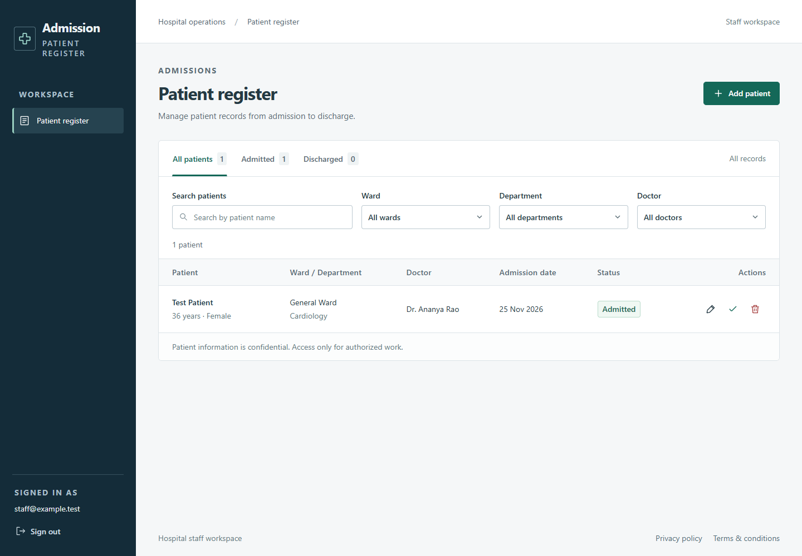
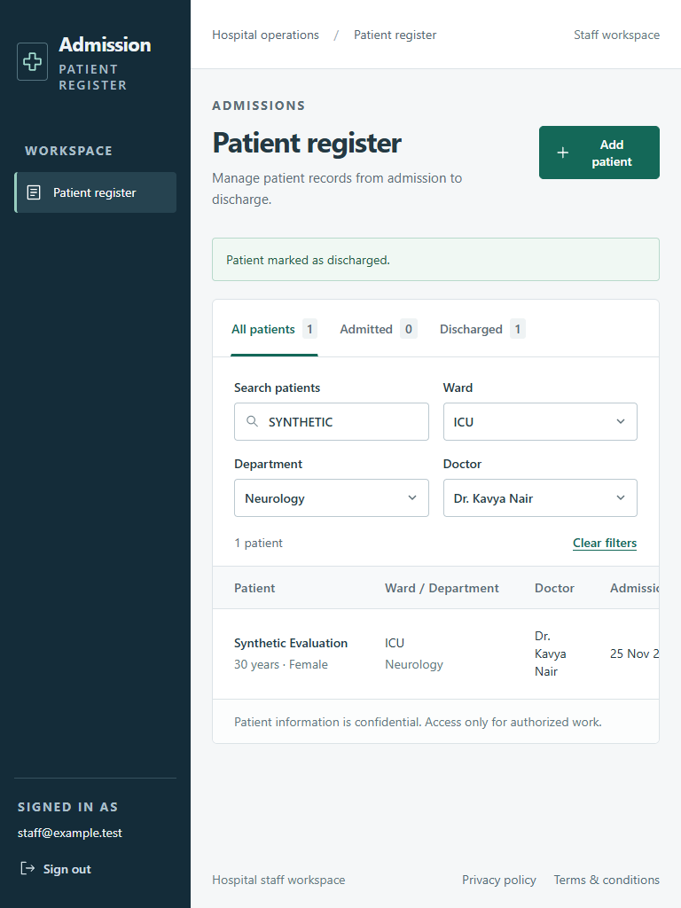
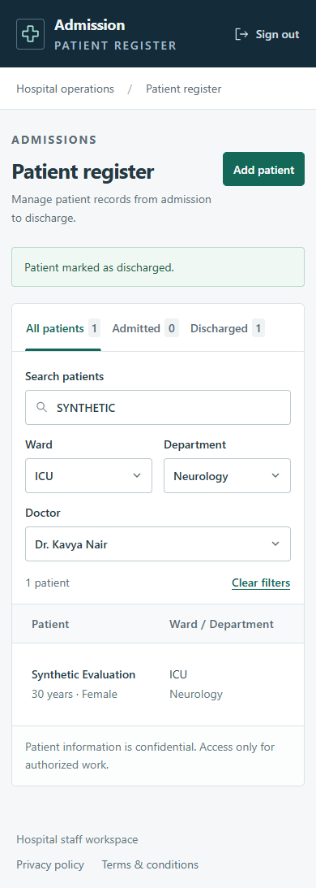

# Patient Admission Management

A staff workspace for adding patients, searching and filtering admissions, updating records, recording discharges, and deleting records with confirmation.

**Submission status: not yet deployed.** The GitHub repository is configured below. The verified Render live URL is still pending. Do not submit this project until the live URL is filled in and the launch checklist passes.

- **Public repository**: [Vignesh0406/Dscribe](https://github.com/Vignesh0406/Dscribe).
- **Live application**: Pending Render deployment and hosted PostgreSQL setup.
- **Hosting target**: Free Render Docker web service connected to Neon Free PostgreSQL.

## Tech stack

- **Frontend**: React 19, Vite, CSS, native HTML dialogs, Vitest.
- **Backend**: Java 17, Spring Boot 3.5, Spring Security, JDBC, Jakarta Validation.
- **Database**: PostgreSQL hosted on Neon Free for deployment; persistent file-backed H2 for local development. Flyway selects database-specific migrations automatically. Your previous local MySQL installation is not changed or exposed.
- **Deployment**: Multi-stage Docker image. Node is used only to build React assets, never as the backend. Java serves the frontend and API from one origin.

## Features

- Add, list, edit, and delete patients.
- Delete confirmation identifies the record and warns that deletion is permanent.
- Mark patients discharged, with confirmation; view all, admitted, or discharged records.
- Combine ward, department, doctor, and case-insensitive name filters.
- Validate names, whole-number ages from 0 to 120, all selected options, status, and admission dates on both frontend and backend.
- Admission dates use Asia/Kolkata and cannot be in the future.
- Names allow Unicode letters, associated combining marks, and spaces, with at least one letter. Apostrophes, digits, and hyphens are excluded to follow the assignment's letters-only rule.
- Staff email/password login and logout. No public signup or email delivery.
- Responsive workspace, favicon, privacy policy, and terms pages. No analytics, fabricated records, reviews, counters, badges, or external photos.

## Assignment checklist

| Mandatory requirement | Current status |
| --- | --- |
| Name, age, gender, ward, department, doctor, admission date, status | Implemented |
| Add and list all patients | Implemented and locally verified |
| Combined ward, department, doctor filters | Implemented and locally verified |
| Search by patient name | Implemented and locally verified |
| Edit a patient | Implemented and locally verified |
| Delete with confirmation | Implemented and locally verified |
| Mark a patient discharged | Implemented and locally verified |
| Mobile, tablet, desktop layout | Browser verified; screenshots below |
| Frontend and backend validation with clear API errors | Automated tests pass |
| React frontend and Java backend, not a Node backend | Implemented |
| Data survives server restart | Abrupt-restart persistence test passes locally |
| Public GitHub repository | Available above |
| README stack, run instructions, screenshots | Included |
| Connected frontend/backend live link | **Pending Render deployment and hosted PostgreSQL** |
| Submission email with full name and both links | **Pending live link and applicant full name** |

Sign-in is an additional staff-access safeguard, not an assignment requirement. Reviewers will need credentials supplied privately, outside the public repository.

## Run locally

**Prerequisites:** Java 17, Maven 3.6.3 or newer, Node 22.16 or newer, and npm. No local database server is required. Commands below use PowerShell from the repository root. On Windows, `npm.cmd` avoids execution-policy issues with npm's PowerShell shim.

### 1. Start Java

From the repository root:

```powershell
$env:ADMIN_EMAIL = 'your-staff-email@example.com'
$securePassword = Read-Host 'Initial staff password (12 to 128 characters)' -AsSecureString
$env:ADMIN_PASSWORD = [System.Net.NetworkCredential]::new('', $securePassword).Password
mvn.cmd -f .\backend\pom.xml spring-boot:run
```

The API listens at `http://localhost:8080`. Local patient and staff data are saved in the H2 file under `.\data` relative to the Java process's working directory. Start from the same directory on subsequent runs. The local file is ignored by Git and survives Java restarts. Production uses Neon PostgreSQL instead of container-local files.

The staff account is created only if its email does not already exist. To rotate an existing staff password, set `ROTATE_ADMIN_PASSWORD=true` together with that account's `ADMIN_EMAIL` and a new `ADMIN_PASSWORD`, restart once, then remove the rotation flag and password. Existing sessions are invalidated on their next request. No default staff credentials are shipped.

### 2. Start React in a second terminal

```powershell
Set-Location .\frontend
npm.cmd ci
npm.cmd run dev
```

Open `http://127.0.0.1:5173`. Vite proxies API requests to Java. If port 8080 is occupied, set `PORT` for Java and `API_PROXY_TARGET` for Vite to the same API address before starting each process.

## Production build and local preview

```powershell
npm.cmd --prefix .\frontend ci
npm.cmd --prefix .\frontend run build
New-Item -ItemType Directory -Force .\backend\src\main\resources\static | Out-Null
Copy-Item -Recurse -Force .\frontend\dist\* .\backend\src\main\resources\static\
mvn.cmd -f .\backend\pom.xml verify
java -jar .\backend\target\admissions-1.0.0.jar
```

The generated static directory is ignored by Git. Re-copy after rebuilding React. Docker performs these steps automatically and runs backend tests during its build. The final image runs Java as a non-root user.

## Tests

```powershell
mvn.cmd -f .\backend\pom.xml test
npm.cmd --prefix .\frontend test
npm.cmd --prefix .\frontend run build
```

Backend integration tests exercise CRUD, combined filters, literal wildcard search, invalid names, age bounds, fractional ages, dropdown tampering, missing fields, future and malformed dates, edit validation, authorization, CSRF, missing records, and login/session protections. GitHub CI runs the same backend suite against both H2 and a real PostgreSQL 17 service; CI credentials exist only for that temporary test database.

An additional Windows smoke test starts an isolated Java server, saves a synthetic patient, abruptly terminates Java immediately after the acknowledged write, restarts it against the same file database, verifies the patient, and deletes the record:

```powershell
powershell -NoProfile -ExecutionPolicy Bypass -File .\scripts\verify-restart.ps1
```

It uses port 8082 by default and a unique ignored local database. The local H2 configuration uses `WRITE_DELAY=0` so acknowledged changes are flushed without the default delayed-write window. This portable smoke test uses H2, not your hosted PostgreSQL database. The CI integration suite provides real-PostgreSQL API coverage; deployment persistence must also be checked against Neon.

## Screenshots

Actual local application screenshots at desktop, tablet, and mobile widths. All pictured patient records are explicitly synthetic QA records, not real patients. Displayed counts come from the database; no sample records are seeded into the application.

### Desktop



### Tablet



### Mobile



## Render deployment

**Deployment will use Render's provided HTTPS URL.** A custom domain is optional, as requested. No deployment has been performed as part of this local implementation. The blueprint uses a free Render web service and uses Neon Free PostgreSQL. Use the $0 Free plan on both services; no payment method is required. Free-plan resource limits apply, so this is not an unlimited or guaranteed-uptime service. Render can sleep when inactive, and Neon can suspend compute while preserving stored data.

1. Create a public GitHub repository and push this project. Review staged changes to ensure there are no secrets or local databases.
2. In Render, create a Blueprint from the repository using `.\render.yaml`. The web-service blueprint prompts for an external PostgreSQL connection. No database or paid service is provisioned automatically. No email provider is required.
3. Set the prompted `ADMIN_EMAIL` and `ADMIN_PASSWORD`. Also set `DB_HOST`, `DB_PORT`, `DB_NAME`, `DB_USERNAME`, and `DB_PASSWORD` from Neon. Store them in Render, never in Git. Production connections require verified TLS using Java's trust store. Use the actual Neon hostname and the generated dedicated database credentials, not your local MySQL root login.
4. Use the HTTPS URL assigned by Render. The React frontend and Java API use same-origin relative paths, so no separate frontend/backend URL setting is needed. A custom domain can be added later, but is not required for this submission.
5. Keep automatic deploys off until the database connection and launch checks pass. Do not share a failed or unverified deployment as the submission's live link.
6. Check `/api/health`, staff login, all patient actions, privacy/terms pages, and favicon on the Render URL. Create only clearly fictional test records, then remove them.
7. Create one fictional record, restart the Render service, and verify the record remains. PostgreSQL must be configured in production; do not use ephemeral container H2 storage.
8. Remove `ADMIN_PASSWORD` from Render after successful initial provisioning. The hashed account is stored in PostgreSQL. Keep the database credentials in Render.
9. Replace the pending repository/live fields at the top of this document. Recheck desktop, tablet, and mobile screenshots against the deployed app.

See [Render Docker deployment](https://render.com/docs/docker), [Blueprint reference](https://render.com/docs/blueprint-spec), and [custom domains](https://render.com/docs/custom-domains).

### Free hosting limits

Neon's Free plan has no time limit and requires no credit card, but storage, compute, and network quotas apply. Keep the organization on **Free**, do not enable paid upgrades, and do not add payment details. See [Neon pricing](https://neon.com/pricing) and [Free plan documentation](https://neon.com/docs/introduction/plans).

Render's free web service sleeps after inactivity and has monthly limits. If this workspace already hosts another free service, both consume the same workspace allowance. See [Render's free-plan limitations](https://render.com/docs/free). This project uses Neon rather than Render's time-limited free PostgreSQL offering.

## Security and scope

- Passwords use salted PBKDF2-HMAC-SHA256 hashes, never plaintext storage.
- Login is server-session based, with HttpOnly, SameSite Strict cookies. Production cookies are Secure. Sessions expire after 30 minutes of inactivity and do not survive Java restarts.
- CSRF protection is required on every mutation, including authentication endpoints. The frontend obtains its token from `/api/auth/csrf`.
- Administrator password rotation increments the credential version and invalidates existing sessions on their next request. Account recovery is managed by the installation administrator, not by email.
- Authentication requests are rate limited per instance. Multiple application instances would require a shared limiter and shared session storage.
- All patient endpoints require a staff login. Patient responses have `Cache-Control: no-store`. SQL uses bound parameters.
- The application has a same-origin content security policy and does not permit cross-origin embedding.
- This internship project is **not certified for real patient information**. It lacks a clinical audit log, granular staff permissions, and a hospital-specific retention/consent policy. Use fictional records for review.
- Privacy and terms content describes the actual demo behavior. Before clinical use, the operator must supply its identity, contact details, retention rules, and approved legal text.
- The Render runtime, your Neon PostgreSQL connection, public HTTPS URL, and TLS require environment-specific verification. Do not represent them as verified before testing them.

## Code walkthrough

- **`.\frontend\src\main.jsx`**: Authentication, patient workspace, patient forms, confirmations, and legal pages.
- **`.\frontend\src\api.js`**: Same-origin JSON requests and CSRF headers.
- **`.\frontend\src\validation.js`**: Client-side patient validation.
- **`.\backend\src\main\java\in\dscribe\admissions\PatientController.java`**: Patient validation, filters, and CRUD using JDBC.
- **`.\backend\src\main\java\in\dscribe\admissions\AuthController.java`**: Initial account provisioning, login, logout, and administrator password rotation.
- **`.\backend\src\main\java\in\dscribe\admissions\SecurityConfig.java`**: Session security, authorization, CSRF, and security headers.
- **`.\backend\src\main\resources\db\migration\postgresql\V1__initial.sql`**: PostgreSQL durable schema. The H2-only migrations retain the previous local test schema and checksums.
- **`.\render.yaml`** and **`.\Dockerfile`**: Render resources and the combined React/Java image.

## Submission

After all launch checks pass, email the **public GitHub repository URL** and **live Render URL** to **pramod@dscribe.in** and **suhasm@dscribe.in**. Put your full name in the subject. The task deadline is **25 November 2026, 11:59 PM IST**. Because staff login is an additional feature, arrange reviewer access privately; never put a working staff password in the public repository.
